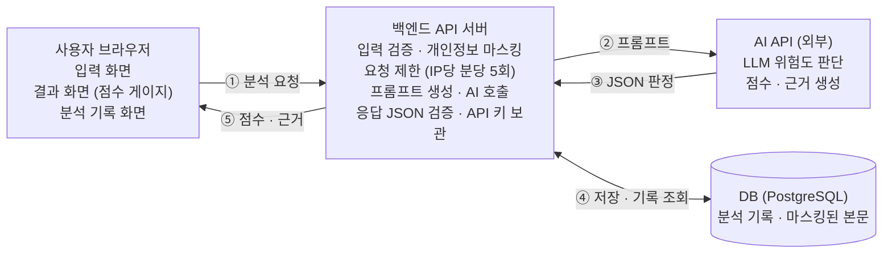
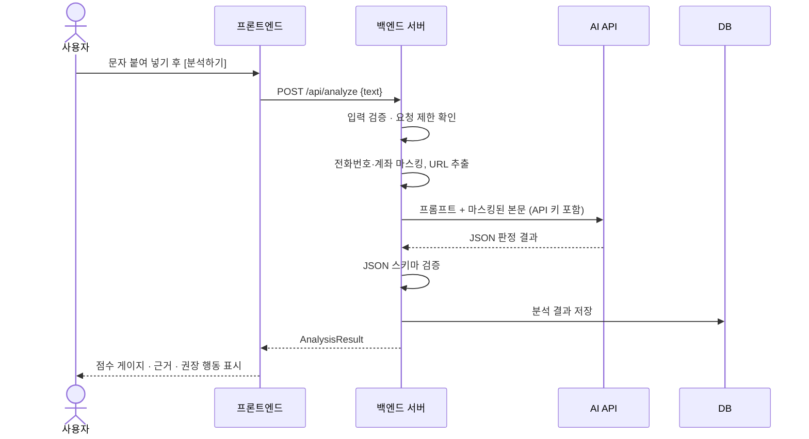

# 설계 문서: 피싱가드 AI — 의심 문자·링크 위험도 분석 웹사이트

| 항목 | 내용 |
| --- | --- |
| 문서 URL | https://claude.ai/artifact/JqJhuMGcY1C7rfcy1QudPc |
| 작성자 | 이재훈 (정보보안학과, 20230861) |
| 작성일 | 2026-10-29 |
| 버전 | v0.1 (초안) |
| 승인 정보 | 검토자: (기재 필요) · 승인일: (기재 필요) |

---

## 1. 목적과 배경

**목적:** 일반 사용자가 받은 의심 문자·링크를 붙여 넣으면 AI가 스미싱 위험도를 0~100점으로 판정하고 근거를 설명해, 클릭·송금 전에 스스로 판단할 수 있게 한다.

**배경**

- **기존 문제:** 택배 조회, 부고장, 청첩장, 공공기관 사칭 등 스미싱 문자는 문구가 매번 바뀌어 사용자가 진위를 가리기 어렵다. 단축 URL과 유사 도메인(예: 정상 도메인의 철자 한 글자 변경)은 겉보기만으로 구분이 안 된다.
- **왜 지금인가:** 대형 언어 모델(LLM) API가 저렴해져, 정해진 키워드 목록이 아니라 문맥(긴급성 유도, 사칭 주체, 개인정보 요구 등)을 읽고 판단하는 분석을 개인 프로젝트 규모로 구현할 수 있게 되었다.
- **이전 시도와 한계:** 통신사·백신 앱의 스팸 필터는 신고된 번호와 URL 블랙리스트에 의존해 신규 문구와 새 도메인에 늦게 반응한다. 사용자가 직접 "이 문자 괜찮나요?"를 물어볼 곳은 지인이나 검색뿐이며, 판단 근거를 설명해 주는 도구는 드물다.

---

## 2. 범위

### 목표 (완료 후 얻는 결과)

1. **입력 화면:** 문자 본문·URL을 붙여 넣는 텍스트 입력창(최대 2,000자)과 분석 버튼.
2. **결과 화면:** AI 판단에 따른 위험도 점수(0~100)와 등급(안전 0~29 / 주의 30~69 / 위험 70~100)을 게이지로 표시하고, 판단 근거·의심 요소·권장 행동을 항목별로 정리.
3. **분석 기록:** 지금까지 분석한 문자의 날짜·요약·점수·등급 목록, 항목 클릭 시 상세 결과 재조회, 개별 삭제.
4. **API 키 보호:** AI API 키는 백엔드 서버 환경변수에만 두고, 브라우저에는 절대 노출하지 않는다.

### 제외 범위

- 회원가입·로그인 (기록은 브라우저별 익명 ID로 구분)
- 휴대폰 문자 앱 자동 연동, 수신 즉시 실시간 차단
- 의심 URL에 실제 접속해 페이지를 열어 보는 동적 분석(샌드박스)
- 이미지(캡처 화면) OCR 분석, 음성(보이스피싱) 분석
- 경찰청·KISA 신고 자동 접수 (신고처 안내 링크만 제공)
- 모바일 네이티브 앱 (반응형 웹으로 대체)

### 사용자 시나리오

1. 사용자가 "[국제발신] 고객님 택배가 주소 불일치로 보관 중입니다. 확인: http://bit.ly/xxxx" 문자를 받는다.
2. 웹사이트에 접속해 문자 전체를 복사해 입력창에 붙여 넣고 **분석하기**를 누른다.
3. 서버가 입력을 검증하고 URL을 추출한 뒤 AI API에 분석을 요청한다. 약 5초 뒤 결과 화면이 뜬다.
4. 결과: **위험 87점**. 근거로 "해외 발신 표시", "택배사 사칭", "단축 URL로 실제 주소 은폐", "주소 재입력 유도"가 나열되고, 권장 행동으로 "링크를 누르지 말고 택배사 공식 앱에서 운송장 조회", "이미 눌렀다면 118 상담"이 안내된다.
5. 이틀 뒤 비슷한 문자를 다시 받은 사용자는 **분석 기록** 탭에서 지난 결과를 열어 비교한다.

---

## 3. 다이어그램

### 구성요소 관계와 데이터 흐름

API 키는 백엔드에만 두고, 브라우저는 백엔드만 호출한다.



### 분석 요청 처리 순서



### 의존 시스템과 프로토콜

| 구간 | 프로토콜 · 형식 | 비고 |
| --- | --- | --- |
| 브라우저 ↔ 백엔드 | HTTPS (TLS 1.2+), REST, JSON | CORS는 서비스 도메인만 허용 |
| 백엔드 ↔ AI API | HTTPS, REST, JSON | 키는 서버 환경변수, 타임아웃 15초 |
| 백엔드 ↔ DB | PostgreSQL 프로토콜 (TCP 5432), TLS | 서버 내부망에서만 접근 |
| 브라우저 로컬 | localStorage에 익명 client_id(UUID) 저장 | 기록 구분용, 개인정보 아님 |

---

## 4. 제약과 SLO

### 제약

| 구분 | 제약 내용 |
| --- | --- |
| 예산 | AI API 사용료 월 3만 원 이하. 요청당 입력 약 1,500토큰·출력 약 500토큰 기준으로 월 3,000건 내외 분석을 상한으로 둔다. 서버는 무료/저가 호스팅 1대. |
| 인프라 | 백엔드 서버 1대 + 관리형 DB 1개. 오토스케일링·멀티 리전 없음. HTTPS 필수. |
| 고객 | 비전문가(고령층 포함)가 쓰므로 결과는 쉬운 한국어, 큰 글씨, 색상+문구 병행 표기. 입력한 문자에는 전화번호·이름 등 개인정보가 섞일 수 있어 저장 전 마스킹한다. |
| 의존 | AI API 장애·지연·요금 정책 변경에 그대로 영향받음. API 키는 서버에만 두고, IP당 분당 5회 요청 제한으로 키 남용을 막는다. AI 판정은 확률적이므로 "참고용" 고지를 결과 화면에 항상 표시한다. |

### 측정 가능한 목표 (SLO)

| 지표 | 목표 | 측정 방법 |
| --- | --- | --- |
| 분석 응답 시간 | p95 10초 이하, p50 5초 이하 | 서버 로그의 요청~응답 시간 |
| 기록 조회 응답 시간 | p95 500ms 이하 | 서버 로그 |
| 가용성 | 월 99.0% (AI API 장애 시간 제외) | 외부 헬스체크 5분 간격 |
| 처리 규모 | 동시 분석 10건, 하루 500건 | 부하 테스트 |
| 판정 정확도 | 검증용 샘플 100건(스미싱 50·정상 50)에서 위험/안전 일치율 85% 이상 | 수작업 라벨과 비교 |
| 오류율 | AI 응답 파싱 실패 1% 이하 | 실패 로그 카운트 |

---

## 5. 인터페이스와 의존성

### REST API (프론트엔드 ↔ 백엔드, JSON over HTTPS)

| 메서드 | 경로 | 설명 | 요청 | 응답 |
| --- | --- | --- | --- | --- |
| POST | `/api/analyze` | 문자 분석 요청 | `{ "text": string(1~2000자) }` + 헤더 `X-Client-Id` | 200 `AnalysisResult` / 400 입력 오류 / 429 요청 초과 / 502 AI 오류 |
| GET | `/api/history?page=1&size=20` | 내 분석 기록 목록 | 헤더 `X-Client-Id` | 200 `{ items: HistoryItem[], total }` |
| GET | `/api/history/{id}` | 기록 상세 | 경로 id | 200 `AnalysisResult` / 404 |
| DELETE | `/api/history/{id}` | 기록 삭제 | 경로 id | 204 |
| GET | `/api/health` | 헬스체크 | — | 200 `{ "status": "ok" }` |

### 분석 결과 형식 (AnalysisResult)

AI에게 아래 JSON 형식으로만 답하도록 시스템 프롬프트로 지시하고, 서버가 스키마 검증 후 저장·반환한다.

```json
{
  "id": "a1b2c3",
  "score": 87,
  "level": "위험",
  "summary": "택배사를 사칭해 단축 URL 클릭을 유도하는 스미싱으로 보입니다.",
  "reasons": [
    { "factor": "사칭", "detail": "택배사 이름을 쓰지만 공식 발신 번호가 아님", "weight": "high" },
    { "factor": "URL", "detail": "bit.ly 단축 URL로 실제 주소를 숨김", "weight": "high" }
  ],
  "urls": [{ "url": "http://bit.ly/xxxx", "risk": "high" }],
  "actions": ["링크를 누르지 마세요", "택배사 공식 앱에서 직접 조회하세요"],
  "createdAt": "2026-10-29T15:59:00+09:00"
}
```

### 백엔드 ↔ AI API

- HTTPS POST, 헤더에 API 키(서버 환경변수 `AI_API_KEY`에서 읽음), 타임아웃 15초, 실패 시 1회 재시도.
- 프롬프트 구성: 시스템 프롬프트(스미싱 판단 기준·점수 기준·JSON 형식) + 사용자 입력(마스킹된 문자 본문, 추출된 URL 목록).
- 입력 문자 속 "이전 지시를 무시하라" 같은 문장은 분석 대상 데이터로만 다루도록 구분자로 감싼다(프롬프트 인젝션 대비).

### DB 스키마 (`analysis` 테이블)

| 컬럼 | 타입 | 설명 |
| --- | --- | --- |
| id | VARCHAR(12) PK | 분석 ID |
| client_id | VARCHAR(36) | 브라우저 익명 ID (UUID) |
| masked_text | TEXT | 전화번호·계좌 등 마스킹된 입력 |
| score | SMALLINT | 0~100 |
| level | VARCHAR(4) | 안전/주의/위험 |
| result_json | JSON | AnalysisResult 전체 |
| created_at | TIMESTAMP | 분석 시각 |

### 사용 기술

| 영역 | 선택 | 비고 |
| --- | --- | --- |
| 프론트엔드 | HTML5 · CSS3 · JavaScript (React 또는 순수 JS) | 반응형, 점수 게이지는 SVG |
| 백엔드 | Node.js + Express (또는 Python FastAPI) | API 프록시, 입력 검증, 요청 제한 |
| 주요 라이브러리 | express-rate-limit, zod(스키마 검증), dotenv | 키 관리·검증 |
| AI | Claude API 등 LLM API | JSON 응답 모드 사용 |
| 저장소 | SQLite(개발) → PostgreSQL(배포) | 기록 저장 |
| 인프라 | 프론트: 정적 호스팅 / 백엔드: 클라우드 서버 1대 | HTTPS, 환경변수로 키 주입 |
| 형상 관리 | GitHub | — |
